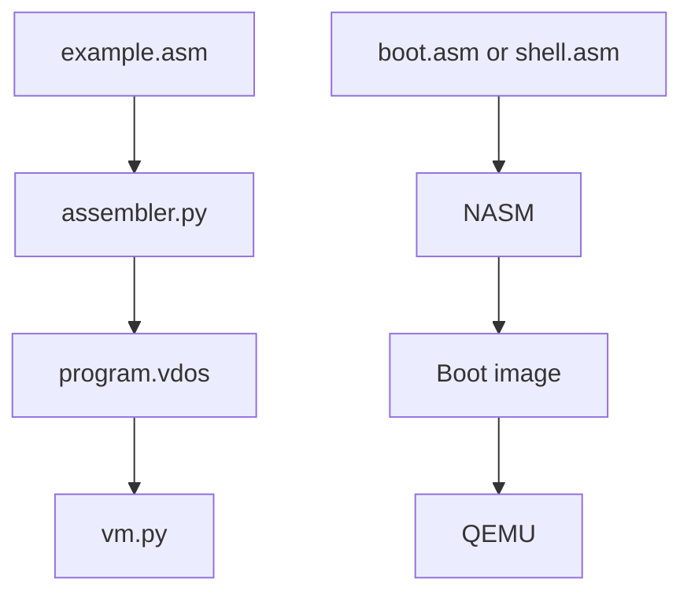

# VDOS

VDOS is a learning project exploring a small bytecode assembler and virtual machine, along with bootable x86 real-mode examples. It is an educational prototype, not a general-purpose operating system.

## Project structure

- assembler/: Python assembler, sample program, bytecode, and VM
- bootloader/: BIOS boot-sector example
- keyboard_shell/: keyboard input and echo example
- command_shell/: command-shell example

## How the pieces fit together

The repository contains two separate learning tracks: a Python bytecode VM and small bootable assembly examples.



## Requirements

- Python 3 for the assembler and VM
- NASM to build the assembly examples
- QEMU to run the bootable images

## Build and run

Run each command from the repository root unless a cd command is shown.

### Bytecode assembler and VM

```sh
cd assembler
python assembler.py
python vm.py
```

The assembler reads example.asm and writes program.vdos; the VM reads that bytecode.

### BIOS bootloader

```sh
cd bootloader
nasm -f bin boot.asm -o boot.img
qemu-system-x86_64 -drive format=raw,file=boot.img
```

### Keyboard echo example

```sh
cd keyboard_shell
nasm -f bin shell.asm -o shell.img
qemu-system-x86_64 -drive format=raw,file=shell.img
```

### Command-shell example

```sh
cd command_shell
nasm -f bin shell.asm -o shell.img
qemu-system-x86_64 -drive format=raw,file=shell.img
```

The command-shell source includes help, clear, and vdos command handlers.

## Bytecode instructions

The sample assembler supports these instructions:

| Instruction | Opcode | Operand |
| --- | --- | --- |
| LOAD | 01 | Numeric value |
| ADD | 02 | Numeric value |
| STORE | 03 | Memory slot A, B, or C |
| HALT | FF | None |

Each instruction is written as an opcode and operand in the generated bytecode. The project is a work in progress; see the source files for current behavior and limitations.
